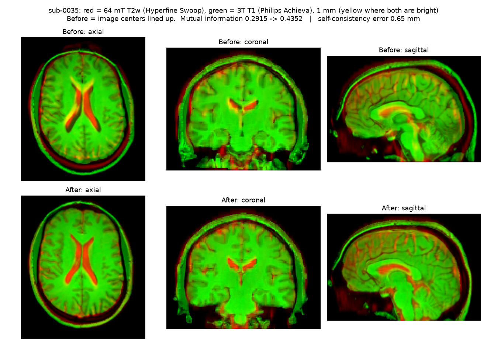

# Aligning a 3T brain MRI to a real 64 mT low-field scan

A small Python + SimpleITK project. It takes a sharp 3T hospital brain scan and lines it up
with a scan of the same person from a portable 64 mT low-field scanner (Hyperfine Swoop),
then measures how well it worked.

Portable low-field MRI scanners make blurrier, noisier images than hospital 3T scanners. If
a patient already has a 3T scan, aligning it to the new low-field scan lets you compare the
two or use the sharp scan to help read the blurry one. The first step is registration:
finding the rotation and shift that line the scans up.



## Results (sub-0035, 64 mT T2 <- 3T T1)

| | Before | After |
|---|---|---|
| Mutual information (higher = more aligned) | 0.292 | 0.435 |
| Self-consistency error, mean over the head | 18.4 mm | 0.65 mm |
| Self-consistency error, worst case | 27.8 mm | 1.02 mm |

"Before" means the two image centers lined up, with no rotation. In raw scanner coordinates
the scans don't overlap at all: the two scanners' coordinate systems are about 22 cm apart
(mutual information 0.00).

The 64 mT voxels are 1.6 x 1.6 x 5 mm, so the remaining error is smaller than one voxel.

## Data

[Paired 64mT and 3T Brain MRI Scans of Healthy Subjects for Neuroimaging Research](https://doi.org/10.5281/zenodo.20281403)
(R.B. van den Broek, B. Lena, A. Webb; C.J. Gorter MRI Center, Leiden University Medical
Center), Zenodo record 20281403 (v5), **MIT license**. 86 low-field sessions from 66 healthy
volunteers; 11 of them were also scanned at 3T (same subject IDs in both folders). The
data are in BIDS format (NIfTI) and defaced.

| Scan | Scanner | Voxels |
|---|---|---|
| T2-weighted (fixed image) | Hyperfine Swoop, 64 mT | 1.6 x 1.6 x 5 mm |
| T1-weighted, 3D (moving image) | Philips Achieva dStream, 3T | 1 x 1 x 1 mm measured (file interpolated to 0.49 mm in-plane) |

> van den Broek, R.B., Lena, B., & Webb, A. (2026). Paired 64mT and 3T Brain MRI Scans of
> Healthy Subjects for Neuroimaging Research (v5). Zenodo. https://doi.org/10.5281/zenodo.20281403

## How it works

1. **Load and clean.** The 3T T1 is put on a 1 mm isotropic grid (its true measured
   resolution). The background of both scans is zeroed with a head mask (Otsu threshold
   on a smoothed copy, then fill holes).
2. **Normalize intensities.** Both scans are clipped to their 1st-99th percentile and
   scaled to 0-1, so a few very bright voxels don't control the result.
3. **Starting guess.** The two scanners use unrelated coordinate systems, so the
   registration starts by lining up the image centers (`CenteredTransformInitializer`,
   GEOMETRY), and also tries lining up the centers of mass (MOMENTS). It keeps whichever
   ends with higher mutual information. Here both reach the same answer.
4. **Rigid registration** (`sitk.ImageRegistrationMethod`):
   - Transform: `Euler3DTransform`, 3 rotations + 3 shifts, since it's the same head.
   - Metric: Mattes mutual information. T1 and T2 have opposite contrast (fluid is dark on
     T1 and bright on T2), so matching intensities directly would fail. Mutual information
     only asks that one image's intensities predict the other's.
   - Optimizer: regular-step gradient descent, run coarse-to-fine (images shrunk 4x, then
     2x, then full size) so it doesn't get stuck on small details early.
5. **Check the answer without ground truth.** Real scans have no known "correct" movement,
   so the test is self-consistency: rotate and shift the 3T scan by a known amount (6, -4,
   9 degrees; 7, -12, 5 mm), register again from scratch, and compare the new answer with
   the first one plus that known movement. The error is the distance between where the two
   send each head voxel.

Bias field: the 64 mT T2 brightness varies by about +-15% across the head. Correcting it
with N4 changed the result by 0.2 mm on average, so it is not used.

### Orientation (LPS vs RAS)

NIfTI files describe positions in RAS (+x toward the patient's Right, +y Anterior,
+z Superior). ITK/SimpleITK and DICOM use LPS (+x toward Left, +y Posterior, +z Superior),
so SimpleITK flips the sign of x and y when it reads a NIfTI. Every image here then lives
in LPS millimeters, and each image's direction matrix says how its voxel grid is tilted in
that space. (Mixing the two conventions by hand is a classic way to get a left-right
flipped result.)

## Run it

```bash
python -m venv .venv && source .venv/bin/activate
pip install -r requirements.txt
python download_data.py   # 1.4 GB from Zenodo, unpacked to data/leiden/
python register.py        # about 30 seconds
```

The subject and which 64 mT scan to use are constants at the top of `register.py`.
Outputs go to `results/`: the overlay and checkerboard images, the optimizer curve,
`results.json`, the transform (`t1_to_lowfield.tfm`), the 64 mT scan (`lowfield.nii.gz`)
and the 3T T1 aligned to it (`t1_aligned_to_lowfield.nii.gz`).

## 3D viewer

A browser viewer built on [NiiVue](https://github.com/niivue/niivue) shows the 64 mT scan
(green) on the sharp 1 mm 3T T1 (magenta) in axial, coronal, sagittal and 3D at once, with
a before/after toggle. Where both scans are bright, green + magenta add up to gray/white.

```bash
python export_viewer.py                  # writes docs/data/
python -m http.server -d docs 8000       # open http://localhost:8000
```

The 64 mT scan is moved into place by rewriting its header (position and orientation), not
by resampling it, so its real 5 mm slices show as-is. The stair-steps in the coronal and
sagittal views are the actual low-field resolution.

## Limits

- One subject (sub-0035) and one 64 mT contrast (T2). 10 more paired subjects are in the
  dataset.
- Rigid only. It doesn't model low-field geometric distortion or brain shape changes
  between the two visits.
- Self-consistency is not ground truth. It shows the method lands in the same place again,
  not that this place is anatomically exact. It is also optimistic, because the moved copy
  is the same 3T image.
- The 3T and 64 mT scans were taken on different days, and the head sits differently in
  each scanner, so there is no "true" movement to compare against.
